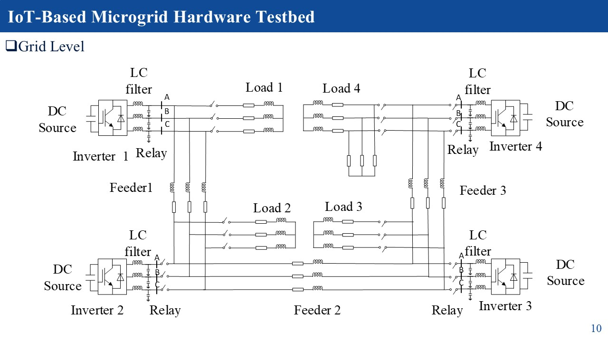

# IoT-Based Microgrid — Simulink Model (Electrical Part Only)

This is a small personal project. I tried to build the **electrical part** of
an IoT-based microgrid testbed in MATLAB/Simulink, just to learn how this kind
of system works and to practice building and tuning it myself.

It is based on a real hardware project built by Jun Zhang:
**[IoT-Based Microgrid Hardware Testbed](https://github.com/JunZhang111/IoT-Based-Microgrid-Hardware-Testbed)**.
That project is real hardware with Raspberry Pis, DSP boards, and an IoT
network (MQTT) connecting everything together, plus a SCADA system for
monitoring and control.

**This project only covers the electrical/power side of that system — the
inverters, filters, cables, and loads, simulated in Simulink.** It does
**not** include the IoT communication part, the Raspberry Pi boards, or the
SCADA software from the original project.



## What is a microgrid?

Normally, electricity comes from one big power plant, through long power
lines, to your home or building. A **microgrid** is a small, local version of
that idea — a handful of power sources working together to supply electricity
to a small area, like a lab, a campus, or a neighborhood. A microgrid can run
connected to the main power grid, or completely on its own ("islanded").

## How does this one work?

This project has **4 small power sources** (called DG1–DG4, short for
"distributed generators"). Each one is an inverter — a device that turns DC
power (like from a battery or solar panel) into the AC power that normal
electrical equipment uses. The 4 inverters are wired together with cables, and
each one also has its own electrical load (something that uses power,
represented here by resistors).

The interesting part is *how the 4 inverters cooperate*. There's no central
computer telling them what to do. Instead, each inverter constantly watches
how much power it's putting out. If it's working harder than the others, it
automatically lowers its own voltage and frequency by a tiny amount — just
enough that some of its load naturally shifts over to the other inverters.
This way, all four end up sharing the total demand fairly, just by each one
reacting to its own output. This technique is called **droop control**, and
it's the standard approach used in real microgrids for exactly this reason.

## What's in the model

Each of the 4 sources (DG1–DG4) is built the same way:

```
DC source → Inverter → Filter → Connection point → On/off switch (relay)
```

They're connected to each other through cables (called "feeders"), and each
one also powers its own local load. One of the loads (Load 4.2) can be
switched on partway through the simulation, so you can see how the system
reacts when the load suddenly changes.

## The model file

- **`model/microgrid_4dg.slx`** — the Simulink model. Built in MATLAB R2025a
  with the Specialized Power Systems library (`sps_lib`).

## Results

See **[`results/RESULTS.md`](results/RESULTS.md)** for the actual simulation
output — voltage, current, power, and frequency plots — plus a plain
explanation of a couple of problems I ran into and how I fixed them.

## What you need to run it

- MATLAB R2025a (or close to it) with Simulink and the Specialized Power
  Systems library (`sps_lib`).
- Just open `model/microgrid_4dg.slx` in Simulink and run it.

## Reference

This project is based on, and uses real hardware parameters published by:

**Jun Zhang** — [IoT-Based Microgrid Hardware Testbed](https://github.com/JunZhang111/IoT-Based-Microgrid-Hardware-Testbed)
(real hardware testbed with IoT communication and SCADA — this project only
reproduces its electrical/power side as a Simulink simulation)
