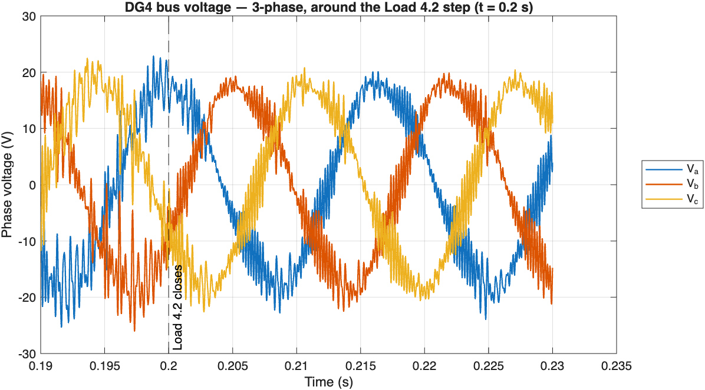
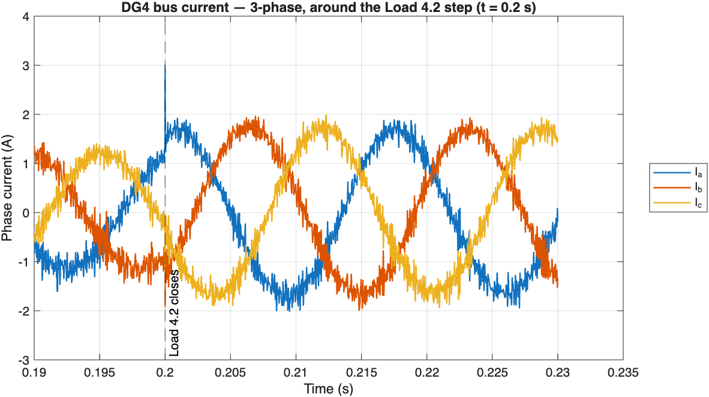
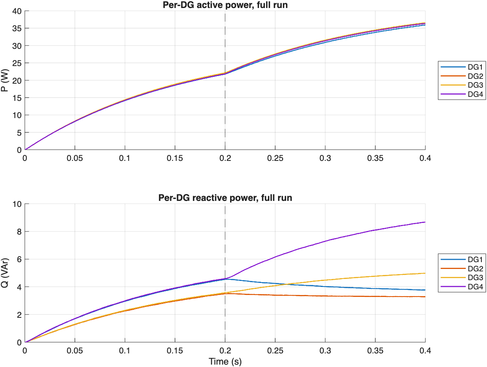
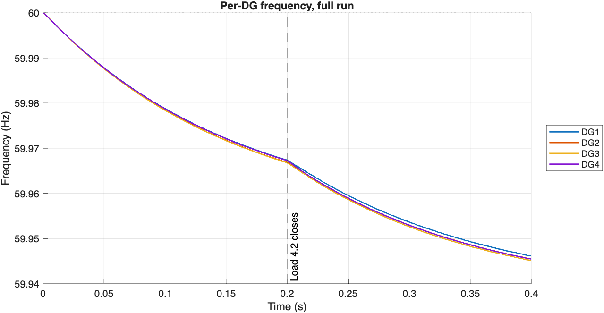

# Simulation Results

This project is based on the real hardware testbed by Jun Zhang:
**[IoT-Based Microgrid Hardware Testbed](https://github.com/JunZhang111/IoT-Based-Microgrid-Hardware-Testbed)**.
The real feeder and load values used below come from that project's published
specs (see "Using the real hardware numbers" below).

## Waveforms (0.4 second run)

**DG4's voltage and current, zoomed in around the moment Load 4.2 switches on
(t = 0.2 s):**

Both look like clean, normal 60 Hz AC sine waves, with a small amount of
expected high-frequency "fuzz" on top. That fuzz is real and normal — the
inverters are simulated as actual switching devices (not simplified/averaged),
so a small amount of switching noise is expected, the same way a real
oscilloscope trace would look. The small spike right at t = 0.2 s is just the
load switching on, not a problem.

**Power and frequency for all 4 inverters, across the whole run:**

All four inverters end up supplying almost the same amount of power and
running at almost the same frequency — meaning they're genuinely sharing the
load between them, not just each doing their own thing.

## Steady-state numbers

| Inverter | Peak voltage | Frequency range | Power at the end | Reactive power at the end |
|---|---|---|---|---|
| DG1 | 21.1 V | 59.946–60.000 Hz | 35.9 W | 3.8 VAr |
| DG2 | 21.1 V | 59.946–60.000 Hz | 36.3 W | 3.3 VAr |
| DG3 | 21.1 V | 59.945–60.000 Hz | 36.6 W | 5.0 VAr |
| DG4 | 21.1 V | 59.946–60.000 Hz | 36.4 W | 8.7 VAr |

Stable the whole time, no errors or blow-ups. All four inverters land within
about half a watt of each other — that's the load-sharing working correctly.

## Using the real hardware numbers

I originally guessed some of the cable and load values, since I didn't have
them. After finding Jun Zhang's project above, I swapped in the real numbers
from the hardware testbed:

| Part | My guess | Real hardware value |
|---|---|---|
| Cable between inverters (all 3) | 0.3 Ω, 0.2 mH | **0.13 Ω, 3.3 µH** |
| Load 1 | 15 Ω + 5 mH | **10.08 Ω + 6.25 mH** |
| Load 2 | 20 Ω + 5 mH | **28.34 Ω + 8.00 mH** |
| Load 3 | 20 Ω + 5 mH | **25.56 Ω + 1.80 mH** |
| Load 4 (fixed part) | 30 Ω + 5 mH | **10.08 Ω + 6.25 mH** |
| Load 4 (switchable part) | 10 Ω | 10 Ω (I had this one right already) |

## Two problems I ran into, and how I fixed them

### 1. The inverters fought each other instead of sharing the load

At first, when each inverter tried to adjust its own voltage/frequency based
on how much power it was supplying (droop control), the whole system became
unstable — power kept growing out of control instead of settling down.

The reason: the cables connecting the inverters are mostly resistive (more
like a simple resistor than a coil), but droop control normally assumes the
opposite — that cables behave like coils. On a network shaped the "wrong way"
like this, the inverters' attempts to correct themselves made things worse
instead of better.

**The fix:** I added something called a *virtual impedance* — basically, each
inverter pretends there's a bit of extra "coil-like" cable between it and the
rest of the network, even though there isn't one physically. This small trick
makes the network behave the way droop control expects, so the inverters can
cooperate properly instead of fighting each other.

### 2. The current waveform looked noisy/jittery

Even once the system was stable, the current waveform looked much noisier
than expected — far more than the normal switching noise mentioned above.

The reason: every inverter has a small filter (an inductor + capacitor) that
smooths out its output. That filter has its own natural "ringing" frequency,
and nothing in the original design was damping that ringing down.

**The fix:** I fed a small signal (based on the filter capacitor's current)
back into the controller to actively damp that ringing — the same idea as
feedback used in audio or vibration damping.

**Result:** the noisy part of the current waveform dropped from being over 4
times the size of the normal signal, down to about 1/6th the size.

## Load step test

Load 4.2 (a 10 Ω resistor) switches on at t = 0.2 s. The plots above show a
clean, smooth response — the power and frequency plots show all four
inverters reacting together, not just one inverter struggling alone.

## What's still not perfect

- The inverters' ability to automatically adjust to share load (droop
  response) is weaker than the original design aimed for. It's enough to work
  correctly, but there's room to push it stronger in a future pass.
- The virtual impedance trick lowers the output voltage a bit under load
  (about 21 V instead of around 30 V) — a known side effect of the fix, not a
  mistake.
- The IoT communication, Raspberry Pi secondary control, and SCADA monitoring
  from the original hardware project are not part of this model — this
  project only covers the electrical/power side in simulation.
